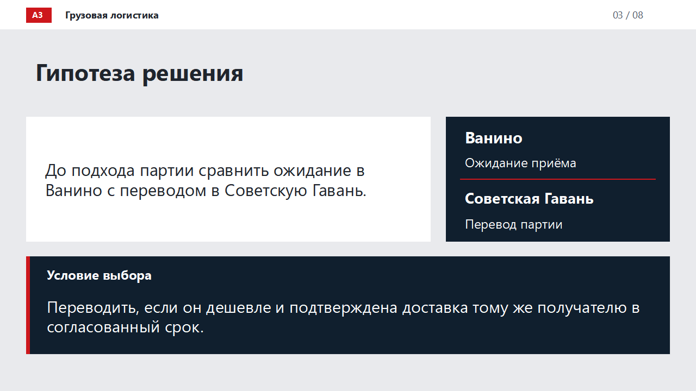

# Раннее перенаправление контейнерных партий

**Ванино — Советская Гавань · кейс А3 «Как выбрать конкретное улучшение перевозок» · МАИ, 2026**

Проект предлагает правило выбора между ожиданием приёма в Ванино и ранней передачей партии соседнему терминалу. Решение учитывает конечную доставку, расходы порта и экономику РЖД, а также распределение эффекта между участниками.

## Гипотеза

**Гипотеза.** Если в Ванино ожидается задержка приёма груза, раннее перенаправление контейнерной партии в Советскую Гавань может снизить расходы порта Ванино.

Перенаправление выгодно, если платежи за ожидание, которых удастся избежать, превышают чистую доплату за перевод, а груз прибывает к тому же получателю в согласованный срок.



## Результат исследования

Построена воспроизводимая модель для партии **20 гружёных C40 на 20 платформах**. Она определяет, когда передача окупается, кому нужна компенсация и при каких условиях решение следует отклонить.

| Проверяемый вопрос | Численный результат | Интерпретация |
|---|---:|---|
| Передача при ожидании 4 суток | **−142 336,60 ₽** для Ванино | При базовых расходах ожидание дешевле |
| Передача при ожидании 14 суток | **+61 523,40 ₽** для Ванино | Передача может окупиться при сохранении остальных условий |
| Положительный общий эффект без новой маржи РЖД | **+43 241,76 ₽** на шесть сторон | Условный пример на альтернативных себестоимостях |
| Результат РЖД в том же примере | **+38 241,76 ₽** или **−70 196,60 ₽** | Зависит от соглашения о распределении эффекта |

**Граница вывода:** расчёт показывает условия выгодности. Эпизод задержки подтверждён документально; коммерческие параметры примеров и альтернативное окно требуют проверки на конкретной перевозке. Фактическая экономия не заявляется.

## Как ознакомиться с проектом

1. **[Отчёт исследования](materials/REPORT.md)** — проблема, источники, метод, сравнение «до / после», результаты РЖД и ограничения.
2. **[Презентация, 8 слайдов](presentation/README.md)** — краткое изложение решения, результатов и дорожной карты.
3. **[Итоговое демо](demo/vanino-dashboard.html)** — интерактивный дашборд перенаправления партии. Для работы скачайте [ZIP репозитория](https://github.com/iszenzi/case-championship-hackathon-3-case/archive/refs/heads/main.zip), распакуйте и откройте `demo/vanino-dashboard.html` в браузере.

| Для подробной проверки | Материалы |
|---|---|
| Формулы и денежные потоки | [Экономика](materials/ECONOMICS.md), [входные параметры](model/data/scenarios.json), [результаты](model/results/scenarios.json) |
| Проверяемость исходных сведений | [Источники](materials/sources/README.md), [условия эксперимента](materials/EXPERIMENT.md) |
| Применение и дальнейшая работа | [Дорожная карта](materials/ROADMAP.md) |
| Использование ИИ | [Инструменты и контроль результатов](ai/README.md), [журнал исследования](ai/RESEARCH_LOG.md) |
| Состав заявки | [Соответствие требованиям А3](materials/requirements/CHECKLIST.md) |

## Воспроизведение

Python 3.10+ и Node.js 18+, без дополнительных Python-пакетов:

```bash
python model/scripts/reproduce.py
python -m unittest discover -s model/tests -v
```

[Инструкция по запуску и структуре данных](materials/REPRODUCIBILITY.md). Независимая проверка охватывает 255 наборов параметров, финансовый баланс и отрицательные сценарии. В GitHub Actions выполняются повторный расчёт и проверка воспроизводимости файлов.

Паспорт проекта представлен отдельно. Происхождение материалов и права на источники: [NOTICE.md](NOTICE.md).
