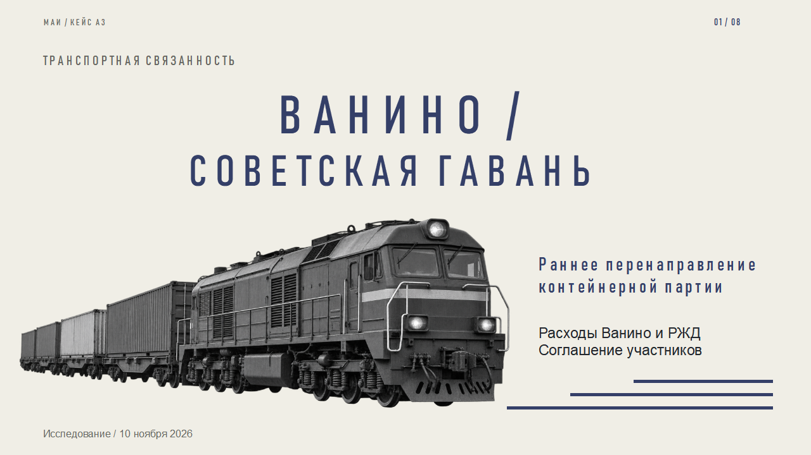
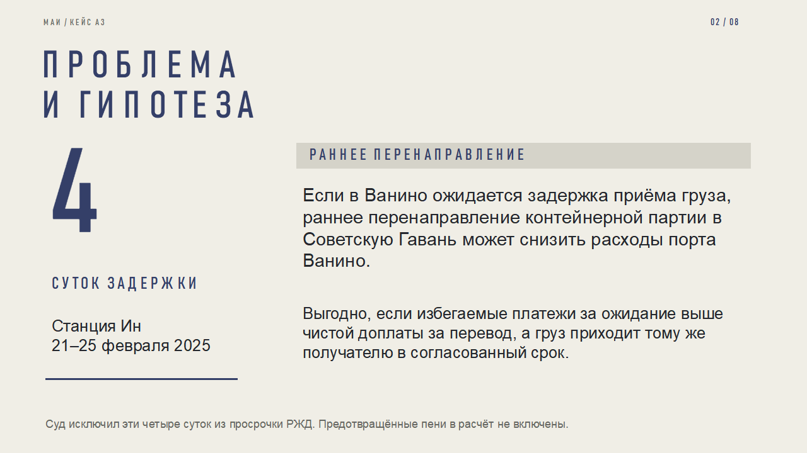
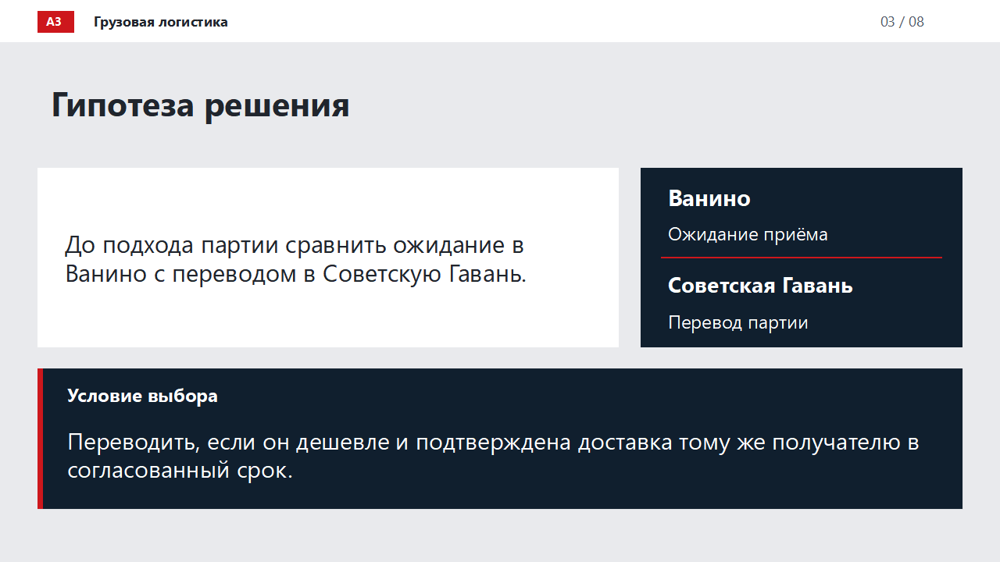
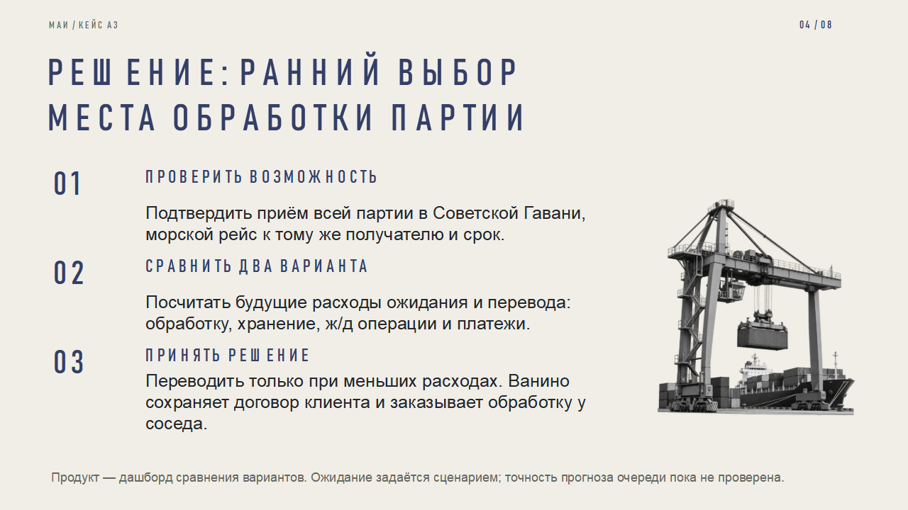
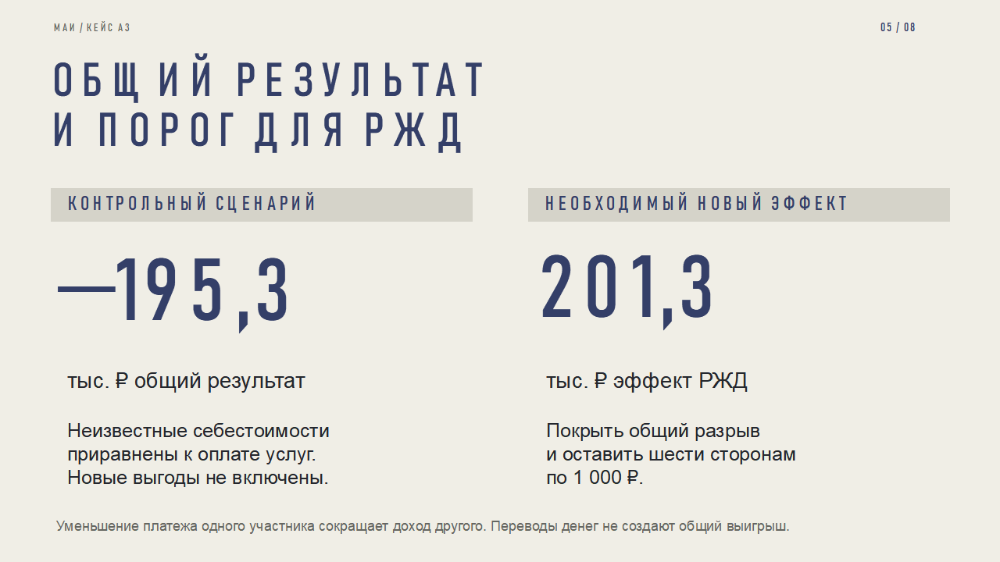
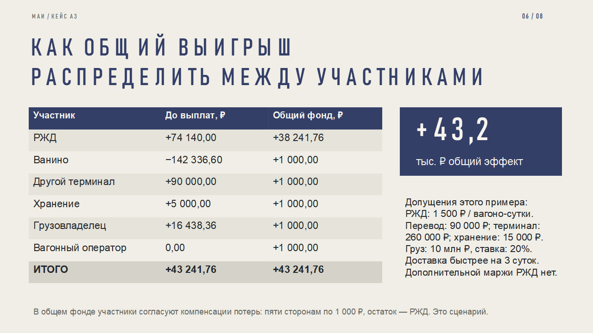
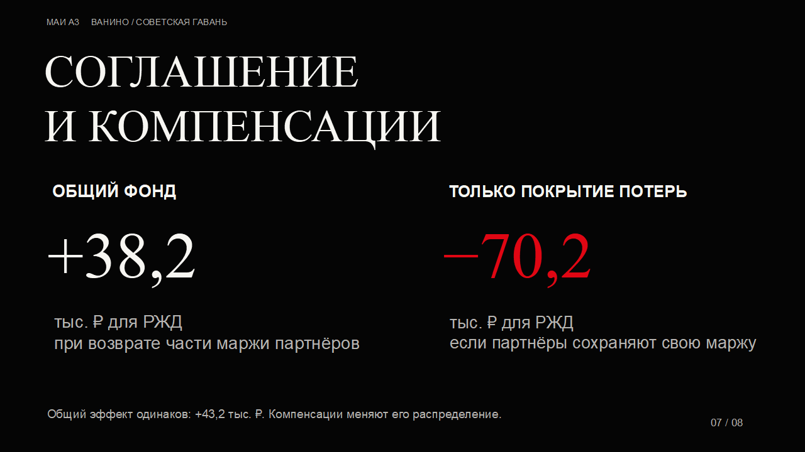
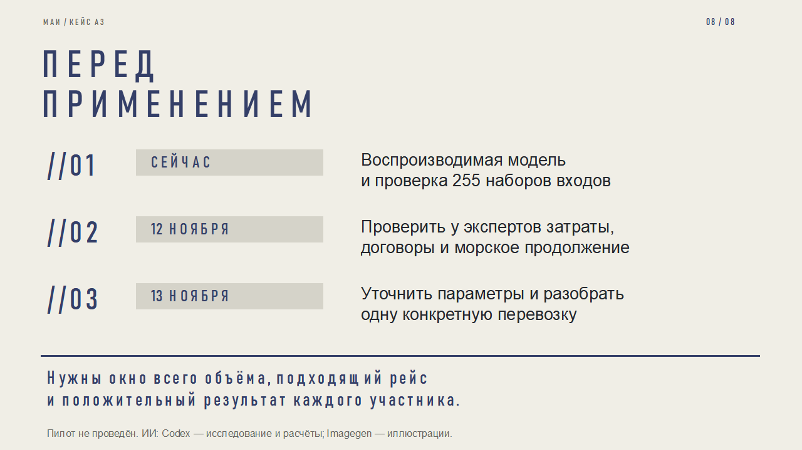

# Презентация для защиты

8 слайдов, ориентир выступления до 5 минут. [Основной PPTX](Vanino_Object_Motion.pptx), [статический резерв](Vanino_Static_Reserve.pptx), [текст выступления](../materials/DEFENSE.md).

Содержание: проблема, ранний выбор терминала, контрольный минус, порог РЖД, условный пример, соглашения и дорожная карта. Дословная итоговая гипотеза приведена в README и тексте выступления. Короткие формулировки слайдов раскрывают ту же сделку.

Файл содержит отдельные анимации объектов, а не только переходы. 63 эффекта распознаны при повторном открытии WPS. Microsoft PowerPoint playback не проверялся. При несовместимости используйте статический резерв. Числа слайдов относятся к сценариям, не к измеренной экономии.

